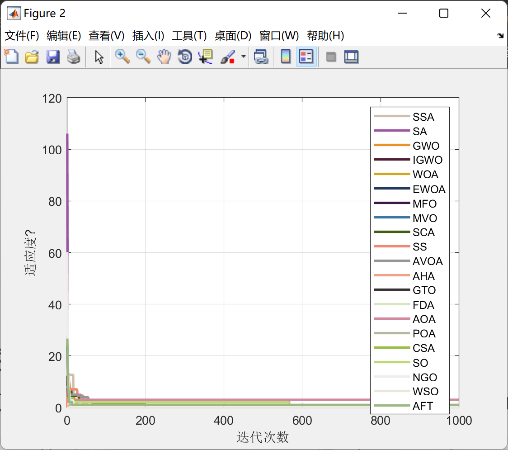
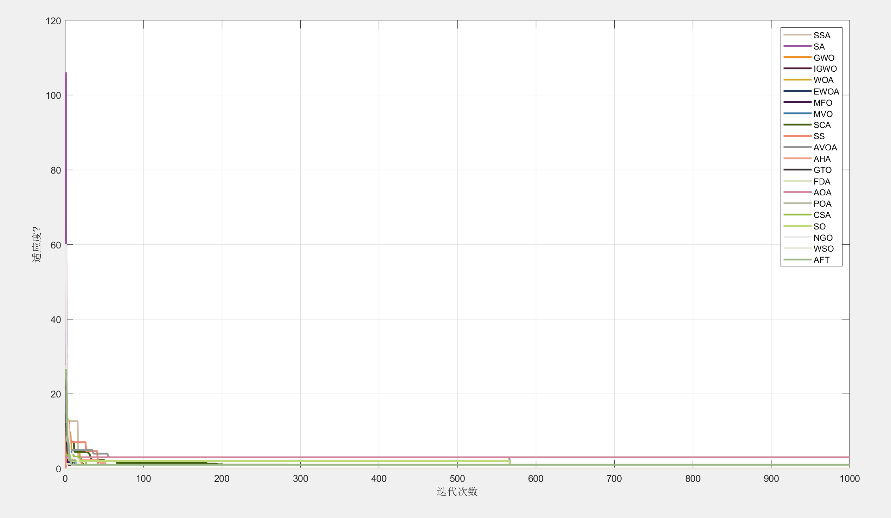
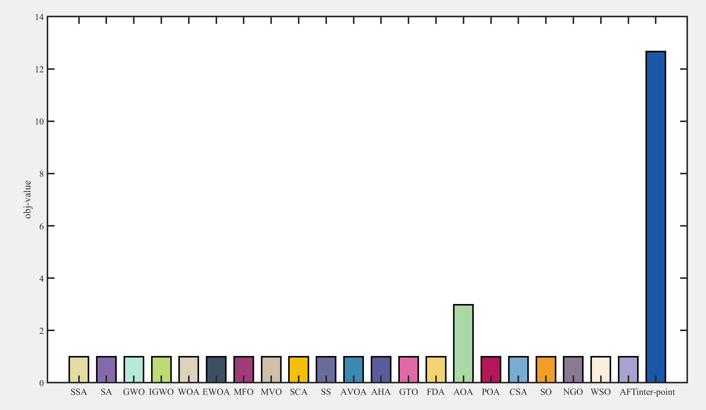

# Optimization Algorithm for Sparrows, Gray Wolves, Snakes, Whales, Gorillas, Ants, Butterflies, Dragonflies, Chameleons, Pelicans, Sea Anemones, and Hawks (Matlab Code Implementation)

Sparrow, gray wolf, snake, whale, gorilla, ant colony, butterfly, dragonfly, tarantula, pelican, sea anemone, vulture - optimization algorithm (Matlab code implementation)

Running results:

## Images

<!-- PAYMENT_BLOCK -->

## Get this dataset

- Payment link (Stripe): [Buy now](https://buy.stripe.com/3cs8yP7sY87d0vu9AB)
- Payment QR code: 

<!-- /PAYMENT_BLOCK -->
